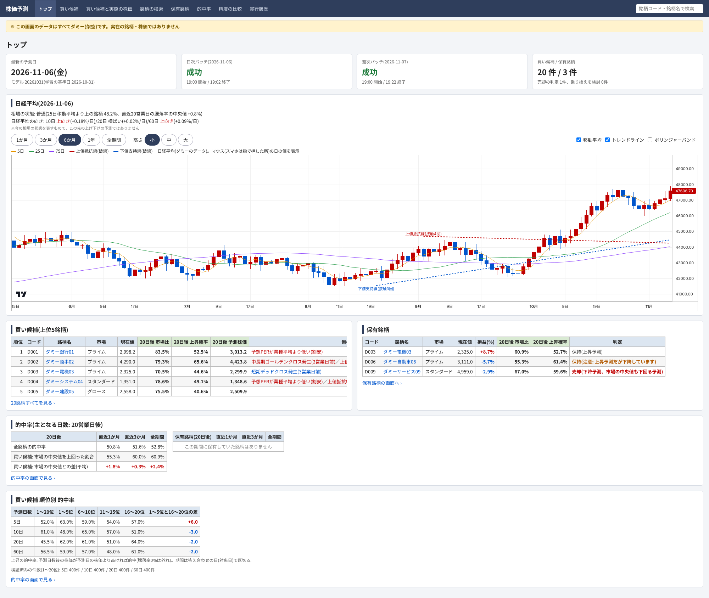
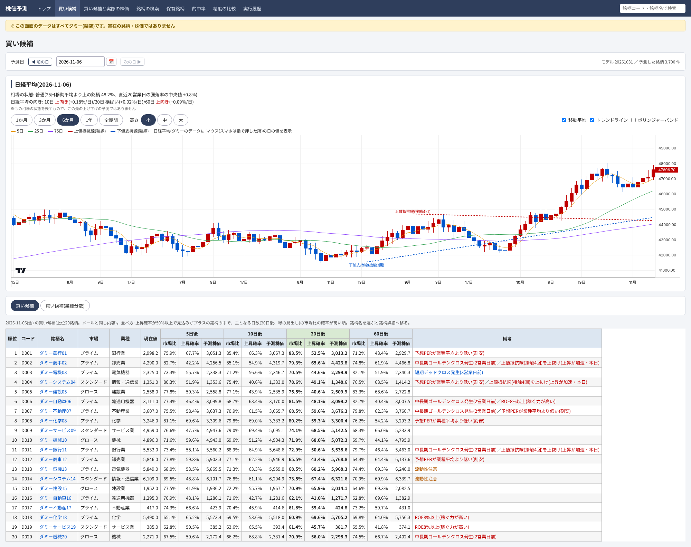
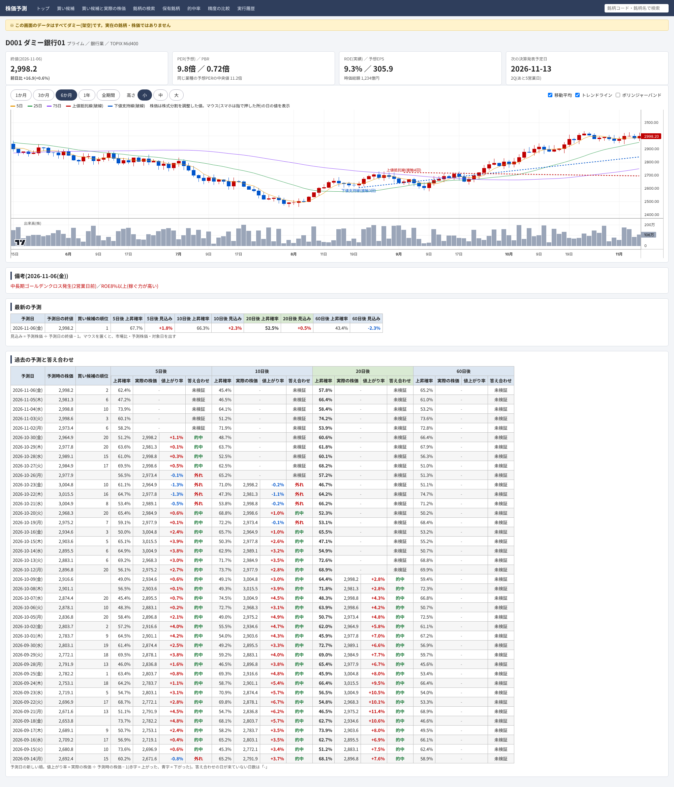
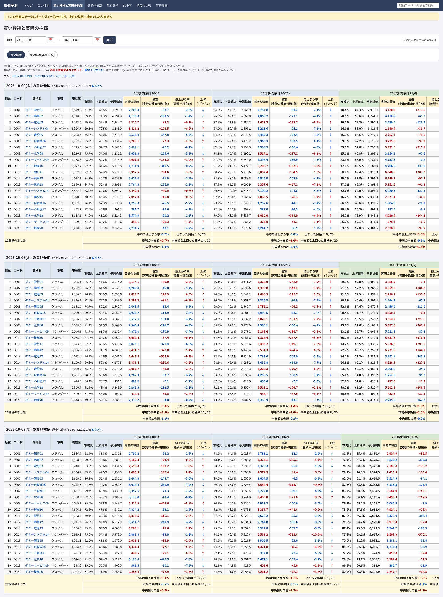
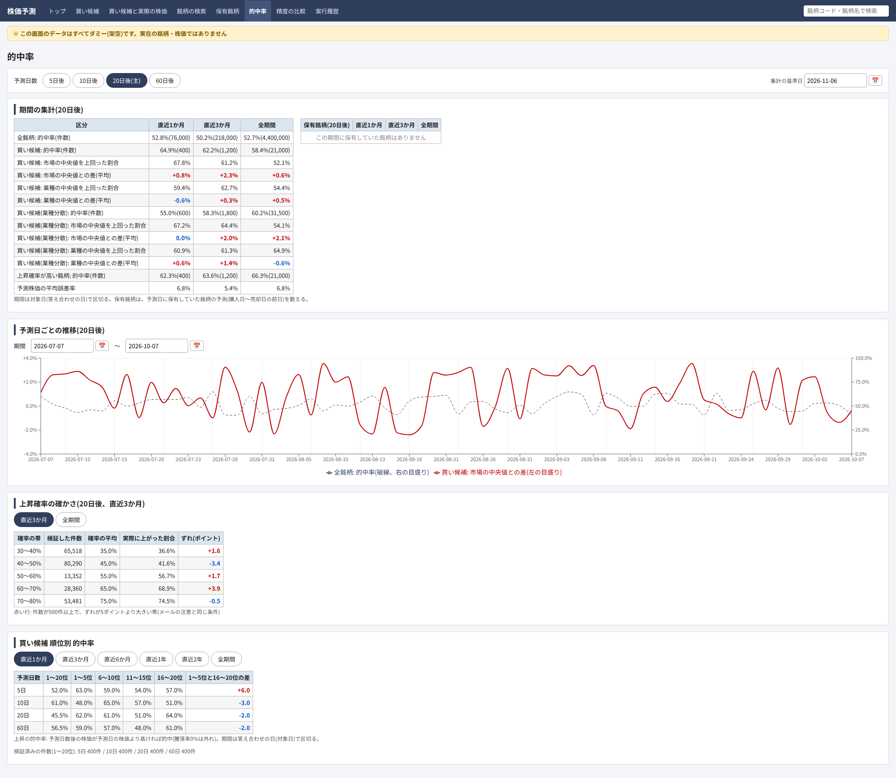
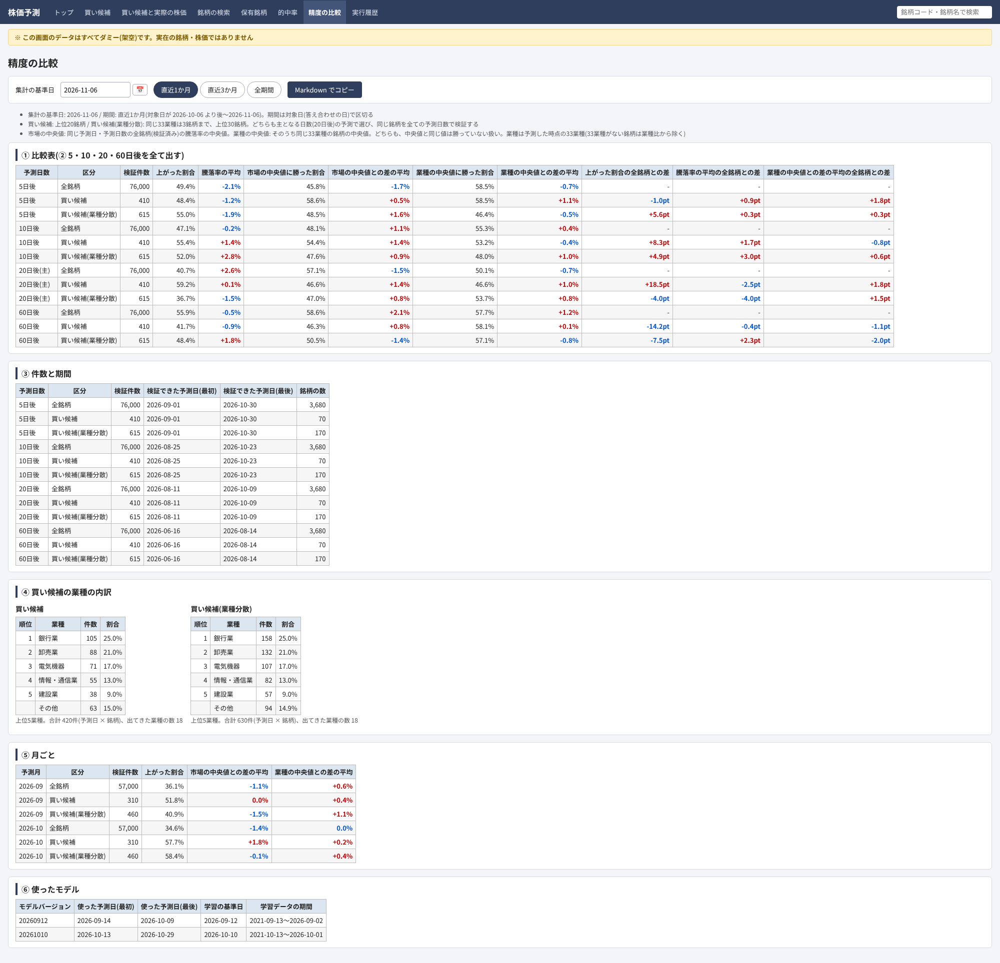
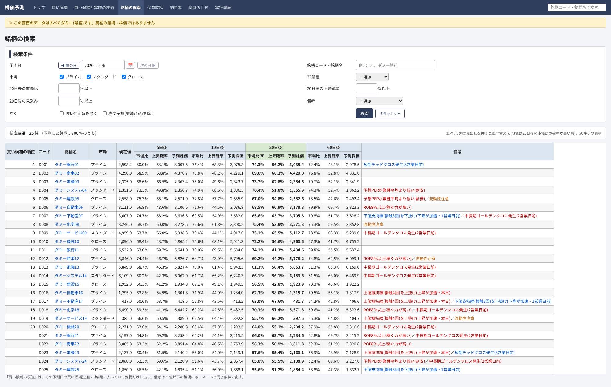
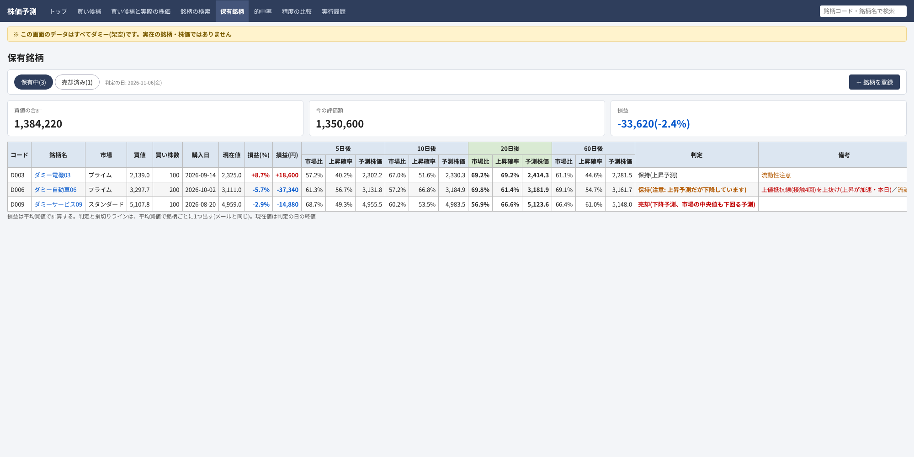
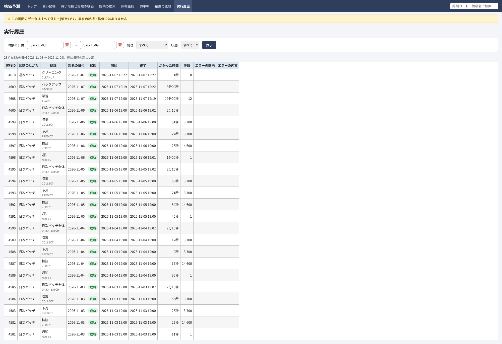

# 株価予測システム

東証の上場銘柄(約3,700銘柄)の株価を毎日集め、機械学習で「N営業日後に上がる確率」と「予測株価」を出すシステムです。
予測から選んだ買い候補をメールで知らせ、結果をブラウザーの画面で確認できます。

| フォルダ | 内容 |
| --- | --- |
| [stock_prediction_batch](stock_prediction_batch) | バッチ(データの収集・学習・予測・検証・通知) |
| [stock_prediction_web](stock_prediction_web) | 画面(予測結果・的中率・保有銘柄の確認) |

## 全体の流れ

```
J-Quants API ──▶ バッチ(収集 → 学習 → 予測 → 検証 → 通知) ──▶ メール
                         │
                         ▼
                    PostgreSQL ◀──▶ 画面(FastAPI + React)
```

- **日次バッチ**(平日の夜): 収集 → 予測 → 検証 → 通知
- **週次バッチ**(土曜の夜): 学習 → バックアップ → クリーニング

## 技術スタック

| 区分 | 使ったもの |
| --- | --- |
| バッチ | Python 3.15、pandas、LightGBM(ライトジービーエム) |
| 画面 | FastAPI(ファストエーピーアイ)、React(リアクト)19、TypeScript、Vite(ヴィート)、Lightweight Charts、Recharts |
| DB | PostgreSQL |
| テスト・品質 | pytest、Vitest(ヴィテスト)、ruff、mypy(strict)、ESLint |
| データ | J-Quants(ジェイクオンツ)API(株価・財務)、yfinance(日経平均) |

## バッチ

- **収集**: J-Quants API から日足・銘柄情報・財務情報を取得します。API の回数制限を守るように呼び出しを調整しています。
- **学習**: 予測日数(5・10・20・60営業日後)ごとに、LightGBM のモデルを3種類(上昇確率・予測株価・市場比)作ります。
- **予測**: 上昇確率を補正してから登録し、上位を「買い候補」として選びます。同じ業種に偏らないようにした「買い候補(業種分散)」も選びます。
- **検証**: 過去の予測と実際の株価を比べ、的中率を記録します。
- **通知**: 買い候補と保有銘柄の判定(移動平均のクロス、トレンドラインの抜けなどの備考付き)をメールで送ります。

## 画面

> 画面の画像は、すべてダミー(架空)のデータで作ったものです。実在の銘柄・株価ではありません。

### トップ

最新の予測日、バッチの実行結果、日経平均のチャート、買い候補・保有銘柄・的中率の要約を1画面で確認できます。



### 買い候補

予測日ごとの買い候補(上位20銘柄)を、予測日数ごとの上昇確率・予測株価・備考と一緒に表示します。



### 銘柄の詳細

ローソク足のチャート(移動平均・トレンドライン・ボリンジャーバンド)と、過去の予測と実際の株価の答え合わせを表示します。

<details>
<summary>画面を見る(縦に長い画像です)</summary>

</details>

### 買い候補と実際の株価

過去の買い候補が、その後どれだけ上がったかを日ごとに確認できます。

<details>
<summary>画面を見る(縦に長い画像です)</summary>

</details>

### 的中率・精度の比較

予測日数ごとの的中率、上昇確率の確かさ(予測した確率と実際に上がった割合のずれ)、買い候補の順位別の的中率を表示します。




### 銘柄の検索

市場・業種・上昇確率・備考などの条件で銘柄を絞り込みます。



### 保有銘柄

保有している銘柄を登録・売却し、損益と売却の判定を確認します。



### 実行履歴

バッチの処理ごとの結果・かかった時間・件数・エラーを確認できます。



## 動かし方

準備と実行の手順は、各フォルダの README を見てください。

- [stock_prediction_batch/README.md](stock_prediction_batch/README.md)
- [stock_prediction_web/README.md](stock_prediction_web/README.md)

## 注意

- 株価の予測は、投資の成果を保証するものではありません。
- J-Quants のデータの利用は、J-Quants の利用規約に従ってください。
- ライセンス: [MIT](LICENSE)。個人・商用を問わず、自由に使用・改変・再配布できます。
